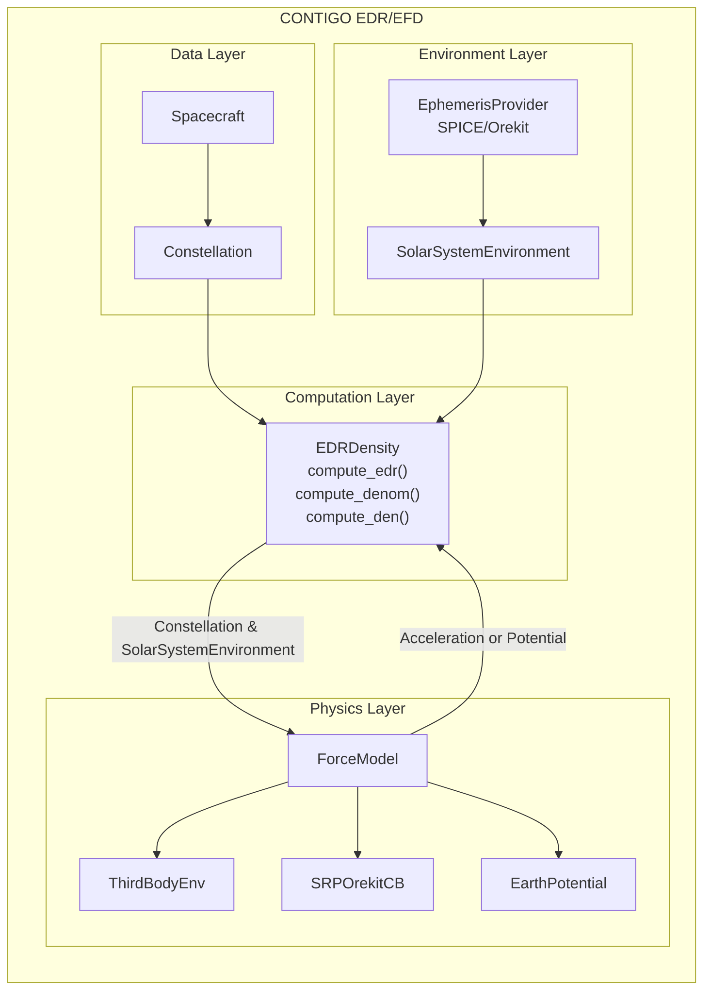

# CONTIGO

[](https://github.com/kylermurphy/contigo_edr/actions/workflows/ci.yml)

[](LICENSE)

CONTIGO computes the **Energy Dissipation Rate (EDR)** and **Effective Density (EFD)** of
Earth-orbiting spacecraft from their orbit data, following
[doi:10.1029/2024EA003898](https://doi.org/10.1029/2024EA003898).

The module:

- loads `Spacecraft` orbit data (arrays, HDF, CSV/text, SP3; one or many satellites);
- groups spacecraft into a `Constellation`;
- loads and caches solar system ephemeris (SPICE or Orekit);
- computes force-model accelerations and the Earth's gravity potential;
- computes the energy dissipation rate and the effective density;
- converts between Earth-fixed, geodetic and inertial coordinates.

It is a **modular framework**: a force is any class that follows the `ForceModel` protocol,
and it can be *plugged into* the main calculation, `EDRDensity`, next to the built-in ones.

## Install

```bash
pip install "contigo[plot] @ git+https://github.com/kylermurphy/contigo_edr.git"
```

Python 3.10 or newer. Java is bundled (through `jdk4py`), so there is nothing else to install.
Some data (Orekit data, large gravity models, newer SPICE kernels) is downloaded on first use
into a per-user cache. For development installs, the cache, offline use (`CONTIGO_OFFLINE=1`)
and HPC, see [docs/installation.md](docs/installation.md).

## Example

```python
import pandas as pd

from contigo.config import data_path
from contigo.constellation import Constellation
from contigo.edr_efd import EDRDensity
from contigo.ephemeris.spice_ephem import SPICEEphem
from contigo.forces.grav_pot import EarthPotential
from contigo.forces.third_body_acc import ThirdBodyEnv
from contigo.solar_system_ephem import SolarSystemEnvironment

# one week of CHAMP orbit data, bundled with the package (positions in km, GPS time)
df = pd.read_hdf(f"{data_path()}/CHAMP_POD_20050816_20050822.hdf", key="CHAMP")

constellation = Constellation(
    state=df[["x", "y", "z", "vx", "vy", "vz"]].to_numpy(),
    time=df["time"].to_numpy(),
    sc_id_input=df["id"],
    tscale_input="GPS",
    unit_input="km",                 # converted to metres internally
    cd=df["cd"].to_numpy(),
    drag_area=df["drag_area"].to_numpy(),
    sc_mass=df["mass"].to_numpy(),
    cr=df["cr"].to_numpy(),
    srp_area=df["srp_area"].to_numpy(),
)

# solar system ephemeris, cached to 0.01 s
ephem = SPICEEphem()                 # or OrekitEphem() from contigo.ephemeris.orekit_ephem
env = SolarSystemEnvironment(bodies=["SUN", "MOON"], tolerance=0.01, provider=ephem)

edr = EDRDensity(
    constellation=constellation,
    solarsys_env=env,
    force_models=[ThirdBodyEnv()],   # add SRPOrekitCB() for solar radiation pressure
    potential_model=EarthPotential(lmax=40),
)

edr_by_id = edr.compute_edr()        # {spacecraft ID: EDR array, m^2/s^2}
efd_by_id = edr.compute_den()        # {spacecraft ID: DataFrame with DateTime and efd}
print(efd_by_id["CHAMP"].head())
```

## Tutorials

| Notebook | Shows | |
|----------|-------|---|
| [Tutorial_Overview](notebooks/tutorials/Tutorial_Overview.ipynb) | Loading spacecraft and constellations, then EDR and EFD with Orekit | [](https://colab.research.google.com/github/kylermurphy/contigo_edr/blob/main/notebooks/tutorials/Tutorial_Overview.ipynb) |
| [Orekit_EDR](notebooks/tutorials/Orekit_EDR.ipynb) | The Orekit route, compared with Orekit's own EDR | [](https://colab.research.google.com/github/kylermurphy/contigo_edr/blob/main/notebooks/tutorials/Orekit_EDR.ipynb) |
| [CONTIGO_Colab](notebooks/tutorials/CONTIGO_Colab.ipynb) | The SPICE route with GMAT solar radiation pressure | [](https://colab.research.google.com/github/kylermurphy/contigo_edr/blob/main/notebooks/tutorials/CONTIGO_Colab.ipynb) |

## How it fits together



### Data layer

**`Spacecraft`** loads orbit data and normalises it:

- accepts NumPy arrays, HDF files, CSV/text files (plain or zipped, several files at once) and
  SP3 files (including `.gz` and `.zip`), for one or many satellites;
- stores the state as `state_ecef = [x, y, z, vx, vy, vz]` in metres and m/s, Earth-fixed
  (`unit_input='km'` converts on load);
- builds three time axes with SPICE: ephemeris time (`sspice_et`), GPS seconds (`sspice_gps`)
  and UTC (`sc_utc`);
- stores physical properties (mass, drag coefficient and area, radiation pressure coefficient
  and area) as one value per sample.

**`Constellation`** splits the data into one `Spacecraft` per ID
(`constellation.spacecraft[id]`). It is iterable, has `.ids`, and constellations can be added
with `+`.

### Environment layer

- **`SPICEEphem`** (`contigo.ephemeris.spice_ephem`) computes Sun, Moon and planet positions
  from JPL kernels with SpiceyPy. The kernels are bundled.
- **`OrekitEphem`** (`contigo.ephemeris.orekit_ephem`) uses the
  [Orekit](https://www.orekit.org/) Java library through
  [orekit_jpype](https://gitlab.orekit.org/orekit/orekit_jpype). CONTIGO's own Java helpers make
  batch calls fast. The JVM starts, and the Orekit data is fetched, on first use.
- **`SolarSystemEnvironment`** caches the ephemeris: times are rounded to `tolerance` seconds,
  and only times not already cached are requested, so spacecraft that share a time axis share
  the work.

### Physics layer

Every force follows the `ForceModel` protocol (`contigo/forces/base.py`): an `acceleration()`
method that returns one `(N, 3)` array per spacecraft, in ECEF and m/s². Built in:

- **`ThirdBodyEnv`**: Sun, Moon and planet tidal accelerations from the `SolarSystemEnvironment`.
- **`SRPOrekitCB`**: cannonball solar radiation pressure via Orekit. (`SRPAcc` does the same via
  GMAT; it is likely to be removed.)
- **`EarthPotential`**: the Earth's gravity potential from spherical harmonics (pyshtools)
  using [ICGEM](https://icgem.gfz.de/tom_longtime) gravity field models. `EIGEN-2` is bundled;
  `EGM2008` and `EIGEN-6C4` are downloaded on first use.

To add a force, see [docs/force_models.md](docs/force_models.md).

### Computation layer

**`EDRDensity`** takes a `Constellation`, a `SolarSystemEnvironment`, a list of force models
and a potential model, and computes:

- `compute_edr()`: the EDR (equations A18 and A19 of the paper);
- `compute_denom()`: the denominator of equation A20;
- `compute_den(window=...)`: the effective density per time window.

### Coordinates

`contigo.contigo_utils.coords` converts ECEF positions to WGS-84 geodetic latitude, longitude
and altitude, and ECEF states to the inertial J2000 frame (with SPICE). See
[docs/coordinates.md](docs/coordinates.md). Plotting functions built on these are in progress
([docs/plotting_plan.md](docs/plotting_plan.md)).

## Documentation

| Page | Contents |
|------|----------|
| [docs/installation.md](docs/installation.md) | Install, bundled and downloaded data, the cache, offline and HPC use |
| [docs/coordinates.md](docs/coordinates.md) | Geodetic and inertial transforms, Earth orientation coverage |
| [docs/force_models.md](docs/force_models.md) | Writing and testing a force model |
| [docs/testing.md](docs/testing.md) | Running the tests, test tiers and the test catalogue |
| [CONTRIBUTING.md](CONTRIBUTING.md) | Setup, branch and pull request workflow, code style |
| [CHANGELOG.md](CHANGELOG.md) | Changes by version |

## Contributing

Contributions are welcome. Read [CONTRIBUTING.md](CONTRIBUTING.md), then:

```bash
pip install -e ".[dev,plot]"
pytest
```

## Citation

If you use CONTIGO, please cite [doi:10.1029/2024EA003898](https://doi.org/10.1029/2024EA003898).

## License

MIT; see [LICENSE](LICENSE).
